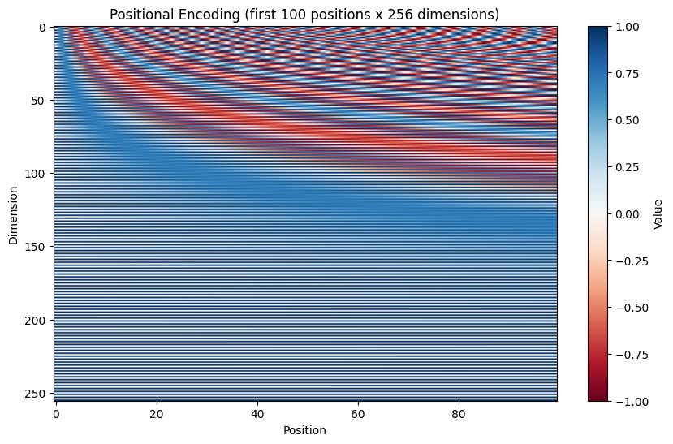
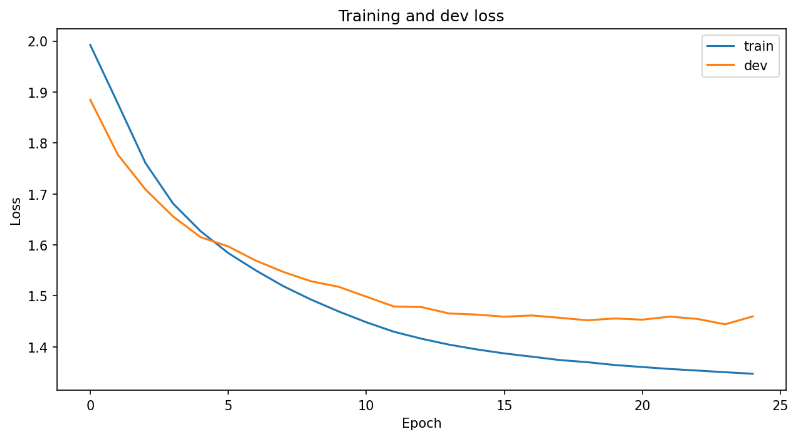
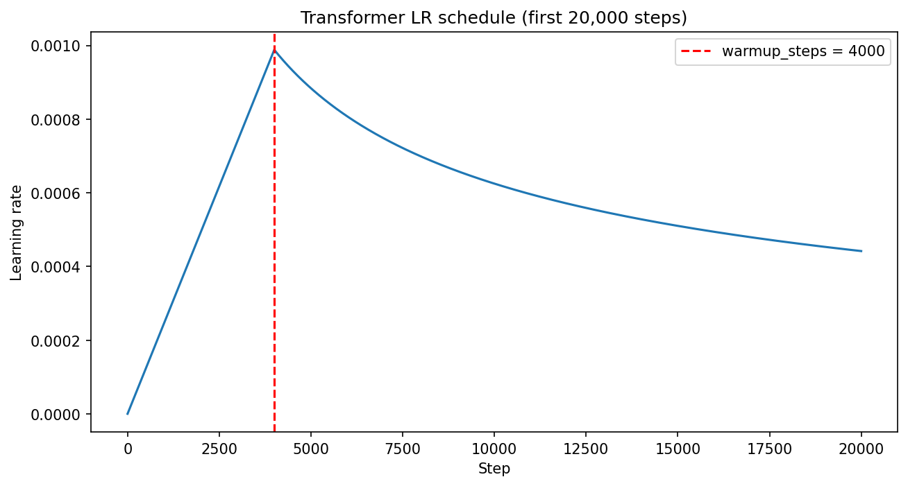
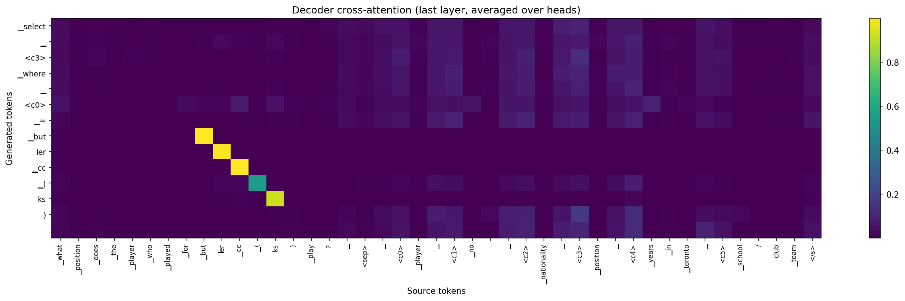

# Text-to-SQL Transformer

An encoder-decoder Transformer, implemented from scratch in PyTorch, that translates natural language questions into SQL — trained on [WikiSQL](https://github.com/salesforce/WikiSQL) (80K+ question/SQL pairs over 24K Wikipedia tables).

```
Question: What school/club team is Amir Johnson on?
Columns:  Player, No., Nationality, Position, Years, School/Club Team
Output:   SELECT School/Club Team FROM table WHERE Player = 'Amir Johnson'
```

## Overview

- Full implementation of ["Attention Is All You Need"](https://arxiv.org/abs/1706.03762) (Vaswani et al., 2017) — scaled dot-product and multi-head attention, sinusoidal positional encoding, post-norm encoder/decoder stacks — built directly from `nn.Linear` / `nn.Embedding` / `nn.LayerNorm` primitives. No `nn.Transformer`, no `nn.MultiheadAttention`, no pretrained weights.
- Trained end-to-end on WikiSQL's 56,355 training examples with a shared BPE vocabulary, label smoothing, and the original paper's warm-up/decay learning-rate schedule.
- Served through a FastAPI backend and a React front end for interactive querying against the trained model.

## Project structure

```
Text_to_SQL_Transformer.ipynb   data pipeline, model, training, and evaluation
backend/                        FastAPI service that loads the checkpoint and runs inference
frontend/                       React interface for interactive querying
results/                        training history and plots
```

## Architecture

| | |
|---|---|
| Embedding dimension | 256 |
| Attention heads | 4 (64 dim each) |
| Encoder / decoder layers | 3 / 3 |
| Feed-forward dimension | 1024 |
| Dropout | 0.1 |
| Normalization | Post-norm, `LayerNorm(x + Sublayer(x))` |
| Weight sharing | Encoder embedding, decoder embedding, and output projection share one matrix |
| Parameters | 7,577,600 |

Source and target share one 8,000-piece BPE vocabulary. Columns are referred to by position tokens (`<c0>`, `<c1>`, ...) rather than by name, so the model has to learn to *point* at the right column instead of memorizing column names.



## Training

25 epochs on a Tesla T4, Adam with the paper's learning-rate schedule (linear warm-up for 4,000 steps, then inverse-square-root decay), cross-entropy loss with label smoothing.




| | |
|---|---|
| Epochs / best epoch | 25 / 24 |
| Best dev loss | 1.4442 |
| Training time | ~27.2 minutes |

## Results

The notebook evaluates generated predictions with its parser and component-level checks. It does not run WikiSQL's official logical-form or execution evaluator, so those metrics are not reported here.

| Split | Decoding | Parse failures |
|---|---|---|
| Dev | Greedy | 1.14% |
| Dev | Beam (4) | 1.14% |

| Component (dev, greedy) | Accuracy |
|---|---|
| Selected column | 92.92% |
| Aggregation | 87.91% |
| WHERE clause (condition set) | 43.70% |

The notebook also verifies the evaluation plumbing by round-tripping gold SQL through the same encoder and parser. It checks that prediction objects can be reconstructed without a parse error; it does not compute an official execution-accuracy score.

Aggregation is learned reliably, since it follows fixed keyword patterns ("how many" → COUNT) that hold across every table. WHERE-clause reconstruction remains the weakest reported component. The cross-attention visualization provides a qualitative explanation: attention for copying values locks onto relevant source tokens, while attention for choosing a column is more diffuse.



On the notebook's 50-example timing sample, greedy decoding takes about 0.055 seconds per example (estimated 7.7 minutes for the dev split); beam search with width 4 takes about 0.213 seconds per example (estimated 29.8 minutes for dev and 56.3 minutes for test).

## Validation

Before trusting the training run, the implementation is checked against a set of behavioral tests, run on random tensors independent of any trained weights:

- **Causal masking** — changing the last token of a decoder input leaves every earlier decoder output unchanged.
- **Padding masking** — appending extra padding to the input leaves the output unchanged; attention weights sum to 1 over the unmasked positions with zero mass on padding.
- **Weight sharing** — the output projection and the embedding table are verified to be the same tensor object, not just numerically equal.
- **Learning-rate schedule** — plotted over 20,000 steps and matches the closed-form warm-up/decay formula.

## Running it

**Train:** open `Text_to_SQL_Transformer.ipynb` in Kaggle or Colab, enable a GPU, and run all cells. It downloads WikiSQL, trains for 25 epochs, evaluates generated predictions on the dev and test splits, and saves the best checkpoint under `checkpoints/best_model.pt` plus the training history under `results/history.json`.

**Backend:**
```bash
cd backend
python -m venv .venv && .venv\Scripts\activate   # .venv/bin/activate on macOS/Linux
pip install -r requirements.txt
uvicorn server:app --port 8000
```
Expects the trained checkpoint and tokenizer generated by the notebook (`checkpoints/best_model.pt` and `sql_sp.model`) — either train it yourself with the notebook or provide the corresponding files to the backend before starting the app.

**Frontend:**
```bash
cd frontend
npm install
npm run dev
```
Opens on `http://localhost:5173`, calling the backend for live predictions.

## Stack

PyTorch · SentencePiece · FastAPI · React

## References

- Vaswani, A. et al. (2017). [Attention Is All You Need](https://arxiv.org/abs/1706.03762). *NeurIPS 2017*.
- Zhong, V., Xiong, C., & Socher, R. (2017). [Seq2SQL: Generating Structured Queries from Natural Language using Reinforcement Learning](https://arxiv.org/abs/1709.00103). *arXiv:1709.00103*.
- [WikiSQL dataset and official evaluator](https://github.com/salesforce/WikiSQL) — Salesforce Research.
